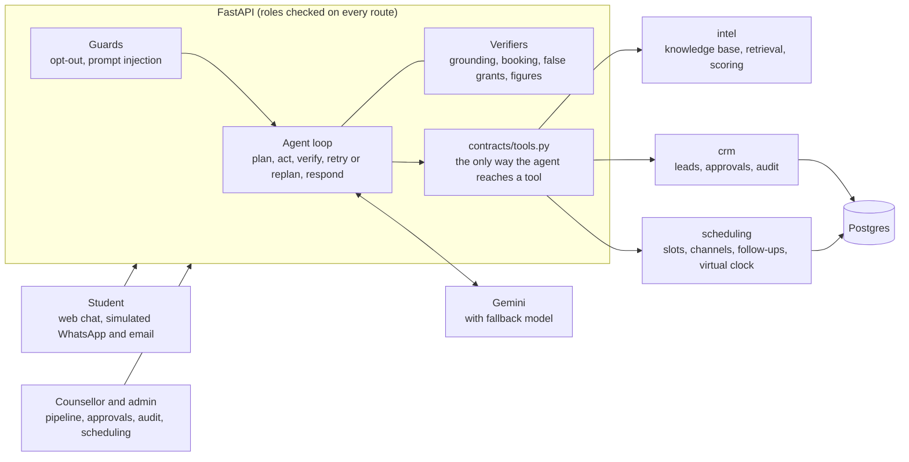

# JKLU Admissions Agent (PS-04)

An agentic AI system for the JKLU AI-Buildathon 1.0 that takes a prospective student from first question to counsellor session. It answers from a verified knowledge base with citations, qualifies and scores the lead, books counsellor slots and handles clashes, plans follow-ups that adapt to the student's behaviour, sends sensitive actions to a human for approval, and records every step in an append-only audit log.

Institutional facts come from JKLU's official website. Student data is synthetic and every integration is simulated: no real student data, no real WhatsApp, email, calendar or CRM.

## Run it

You need Docker Desktop, Python 3.11+, Node 18+ and a [Google AI Studio](https://aistudio.google.com/) API key.

```bash
cp .env.example .env
```

In `.env`, set `LLM_API_KEY`, and set `JWT_SECRET` to the output of:

```bash
python -c "import secrets; print(secrets.token_urlsafe(48))"
```

Then, from the repo root:

```bash
cd backend
python -m venv .venv
.venv\Scripts\activate
pip install -r requirements.txt
python scripts/demo.py --reset
```

On macOS or Linux, activate with `source .venv/bin/activate`. Open <http://localhost:5173>; the login page has one-click demo accounts for each role. API docs are at <http://localhost:8000/docs>.

`--reset` **erases the local `admissions` database** and rebuilds the demo data, including resetting the virtual clock. It refuses to touch any other database. Leave it off to start the servers on your existing data.

To run the pieces yourself:

```bash
docker compose up -d db
cd backend
alembic -c app/crm/db/alembic.ini upgrade head
python -m app.crm.seed
python -m app.scheduling.seed
uvicorn app.main:app --reload
```

```bash
cd frontend
npm ci
npm run dev
```

## How it works



**One chat turn:**

1. **Guards** handle opt-outs and obvious prompt injection before any model call, so neither depends on the model.
2. **Plan:** the model classifies the message and plans steps.
3. **Act:** the model calls tools. Code, not the model, decides which lead a call acts on. Failed tools are retried twice, then fall back to other slots or a human callback.
4. **Verify:** deterministic checks read the draft answer. Every claim needs a source retrieved this turn, every number must appear in the knowledge base or the conversation, no booking may be claimed unless one succeeded, and nothing may be granted without a matching approval.
5. **Respond or recover:** a failed check sends the draft back with the reason. If it can't be fixed, the student is told honestly and the question goes to a counsellor.

The answer is held back until verified, while the plan, tool calls and checks stream live over SSE to the trace panel.

## The knowledge base

Facts live in four Markdown files in `backend/app/intel/data/`, rewritten from [JKLU's official pages](https://jklu.edu.in/admissions/fee-structure) on 7 Nov 2026. They're a snapshot, not a live lookup, so when the site changes, update the files and click **Reload knowledge base** as an admin (or restart the API). Each file names its source pages and the date they were checked. Where the official pages disagree with each other, [the test report](docs/TEST_REPORT.md) lists it.

## Rubric mapping

| Criterion | What to look at | Where |
|---|---|---|
| Agentic capabilities (30) | Visible plan, tool calls and verification; retries, replanning, clarifying questions, slot alternatives, adaptive follow-ups | `agent/loop.py`, `agent/verify.py`, `scheduling/planner.py` |
| Domain accuracy (25) | Answers only from a verified knowledge base, with citations. Not in the KB means refuse and escalate. Retrieval benchmark and live checks in [the test report](docs/TEST_REPORT.md) | `intel/data/`, `intel/retrieval.py`, `agent/verify.py` |
| Architecture (20) | Modules behind one tool contract, migrations, SSE streaming, atomic booking, multi-user sessions | `contracts/`, `crm/db/`, `scheduling/service.py` |
| Safety and governance (15) | Approval gate, roles enforced on the server, append-only audit log enforced by the database | `crm/approvals.py`, `crm/auth.py`, migration `0004` |
| Demo and UX (10) | Role-based dashboards and a five-minute story | `frontend/src/`, [the demo script](docs/DEMO_SCRIPT.md) |

Paths are under `backend/app/`.

## Safety design

- **No invented facts.** Numbers and citations are checked by code against what was retrieved in that turn. Questions the knowledge base can't answer go to a counsellor, whose own words are what the student receives.
- **The agent can't grant anything.** It has no tool that does. Fee waivers, booking overrides and bulk messages become pending approvals, and run only when staff approve, under a row lock so they can't run twice. Claims of approval in a draft are rejected unless an approval of that kind exists for that lead.
- **Roles on the server.** Every route checks the role, and a test fails if a new route is left open by accident. The UI only hides what a role can't use.
- **Append-only audit.** Every agent step, tool call, decision and refused request is logged. A database trigger rejects updates, deletes and truncation, even from direct SQL.
- **Opt-out is a hard stop**, applied immediately and without the model. Later sends are refused in code.
- **Secrets.** `.env` is ignored by git, and the app refuses to issue logins with a placeholder or short `JWT_SECRET`.
- **Limits.** Failed logins and chat messages are rate limited, per process.

## Tests

```bash
cd backend
pytest -q
```

Pytest uses a scripted model and a throwaway database. `python scripts/live_scenarios.py` runs the same scenarios against the real model. Results are in [docs/TEST_REPORT.md](docs/TEST_REPORT.md).

## Layout

```
backend/app/
  contracts/    data shapes, stubs, and tools.py (the agent's only route to tools)
  agent/        loop, verifiers, guards, Gemini client, SSE chat endpoint
  crm/          models and migrations, auth, approvals, reports, seed
  intel/        knowledge base, retrieval, scoring, benchmark
  scheduling/   slots, booking, channels, follow-ups, virtual clock
backend/scripts/   demo.py (one-command demo), live_scenarios.py
backend/tests/
frontend/src/modules/   agent, crm, intel, channels
```

Design details are in [docs/SPEC.md](docs/SPEC.md).

## Known limitations

- **Single process.** Rate limits and the failure demo live in memory, so they reset on restart and aren't shared between API processes.
- **Tokens in `localStorage`.** Fine for a demo; production should use httpOnly cookies. One browser profile holds one login, so use an incognito window to show two roles side by side.
- **Closing the tab mid-reply** can lose that reply, because the turn stops when the connection drops.
- **Anonymous visitors can't see counsellor replies**, since they have no inbox. Staff get a warning first.
- **The knowledge base is a snapshot** of the official pages, so it can fall behind them. The Fee Refund Policy PDF wasn't included.
- **Students see their own lead score** in the trace panel, which is there to show the agent's work.
- **Retrieval is TF-IDF with a relevance threshold**, not embeddings. It's simple and easy to test, but matches wording more than meaning. The Postgres image includes pgvector, which isn't used.
- **Model speed varies.** A timed-out call costs up to 18 seconds before the fallback model answers.
- **Dependency warnings.** `npm audit` reports 4 issues (`vite` high; `esbuild`, `react-router` and `react-router-dom` moderate). Fixing them needs major upgrades, so they're deferred. The app's links are all internal.

## Credits

Started by a four-person team (Rohit, Dev, Guru, Riya) and completed by Rohit with Claude Code. The first versions of the `intel` and `crm` modules came from that team.
