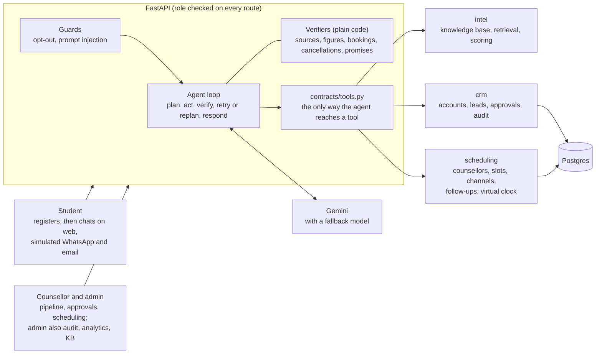

# JKLU Admissions Agent (PS-04)

An AI admissions assistant for JK Lakshmipat University, built for the **JKLU AI-Buildathon 1.0**, problem statement **PS-04: Intelligent Admission Enquiry and Lead Nurturing Agent**.

It takes a prospective student from their first question to a counsellor session. It answers only from JKLU's official information and shows its sources. It learns about the student, scores how ready they are, books counsellor sessions, and follows up depending on how the student responds. Anything sensitive, like a fee waiver, waits for a person to approve it, and every step is written to a log that nobody can edit.

All student data is made up, and WhatsApp, email, the calendar and the CRM are simulated. No real student data or university system is touched.

## Contents

- [What it does, in one minute](#what-it-does-in-one-minute)
- [Who uses it](#who-uses-it)
- [A student's journey](#a-students-journey)
- [Run it](#run-it)
- [Accounts: students, counsellors and admins](#accounts-students-counsellors-and-admins)
- [How the agent works](#how-the-agent-works)
- [Where each judging point is earned](#where-each-judging-point-is-earned)
- [Safety design](#safety-design)
- [Tests and evidence](#tests-and-evidence)
- [Code layout](#code-layout)
- [Words used here](#words-used-here)
- [Known limitations](#known-limitations)
- [Credits](#credits)

## What it does, in one minute

| | |
|---|---|
| **Answers with sources** | Fees, eligibility, scholarships, refunds and more, only from a knowledge base copied from JKLU's official pages. Every fact cites its source. If the answer isn't there, it says so and passes the question to a counsellor. It never guesses. |
| **Qualifies the student** | Collects marks, entrance exam, city and budget during the conversation, then scores the student Hot, Warm or Cold, with reasons a counsellor can read. |
| **Books counsellors** | Books, cancels and moves sessions. If a slot is taken, it offers the nearest free ones. If the calendar fails, it retries, then offers alternatives or a callback. |
| **Follows up** | Plans the next message from the student's tier and replies, for example a reminder for a hot lead or a scholarship note for a student who asked about money. It stops at once if the student opts out. |
| **Asks a person** | Fee waivers, booking overrides and bulk messages become requests that a counsellor approves or rejects. The agent can't grant anything itself. |
| **Keeps a record** | Every plan, tool call, check, approval and refusal goes into an audit log that the database itself won't let anyone change. |

## Who uses it

There are three roles, and the server checks the role on every request (the menu only hides what a role can't use).

| | Student | Counsellor | Admin |
|---|---|---|---|
| **Gets an account by** | Registering in the app | An admin creating it ([how](#adding-a-counsellor-or-admin)) | An admin creating it |
| **Chat with the agent** | Yes | No | Yes, to test it |
| **My messages** (simulated WhatsApp and email) | Yes | No | No |
| **Pipeline and lead details** | No | Yes | Yes |
| **Approvals** | No | Yes | Yes |
| **Scheduling** | No | Yes | Yes |
| **Audit log, analytics, knowledge base, users** | No | No | Yes |
| **Demo tools** (fast-forward the clock, break the calendar) | No | No | Yes |

A counsellor sees only their everyday work. The admin also sees oversight screens and the tools used in the demo.

## A student's journey

1. **Register.** On the **Register** tab: name, email, mobile (+91), state, city, course, lateral entry, a password, and consent to be contacted. They're logged in straight away and land on the chat, greeted by first name.
2. **Ask.** "What is the B.Tech CSE fee?" The agent searches the knowledge base, writes an answer with numbered sources, and code checks every figure against the source before the student sees it.
3. **Share details.** "I scored 94% and got 96 percentile in JEE Main; my budget is 4 lakh." The agent saves each detail, and once enough is known, code scores the lead. On the counsellor's Pipeline, the student moves to **Hot**.
4. **Book.** "Book a session with Ms. Rekha Verma." If someone else has that slot, the agent offers the nearest free ones. The student can also cancel or move a session, and the agent can say who the counsellors are.
5. **Get followed up.** A day later (on the app's virtual clock), the student gets a follow-up chosen for them. One who opted out gets nothing.
6. **Ask for something sensitive.** "Please waive my fee." The agent files a request and says it's pending. A counsellor approves or rejects it, with a reply the student receives.

Behind the chat, **Show how the agent worked** opens the agent's plan, actions and checks for the latest message, in plain language.

## Run it

You need Docker Desktop, Python 3.11+, Node 18+ and a [Google AI Studio](https://aistudio.google.com/) API key.

```bash
cp .env.example .env
```

In `.env`, set `LLM_API_KEY`, and set `JWT_SECRET` to the output of:

```bash
python -c "import secrets; print(secrets.token_urlsafe(48))"
```

Then, with Docker Desktop open, from the repo root:

```bash
cd backend
python -m venv .venv
.venv\Scripts\activate
pip install -r requirements.txt
python scripts/demo.py --reset
```

On macOS or Linux, activate with `source .venv/bin/activate`. The frontend's packages install on the first run.

Open <http://localhost:5173>. API docs are at <http://localhost:8000/docs>.

`--reset` **erases the local `admissions` database** and rebuilds the demo data, including the virtual clock. It refuses to touch any other database. Leave it off to start on your existing data. It also prints the message to type for the booking-clash part of the demo.

To run the pieces yourself instead:

```bash
docker compose up -d db
cd backend
alembic -c app/crm/db/alembic.ini upgrade head
python -m app.crm.seed
python -m app.scheduling.seed
uvicorn app.main:app --reload
```

```bash
cd frontend
npm ci
npm run dev
```

The five-minute demo, step by step, is in [docs/DEMO_SCRIPT.md](docs/DEMO_SCRIPT.md).

## Accounts: students, counsellors and admins

**Chatting needs a login**, so the agent always knows whose record it's working on.

**Demo accounts.** The seed creates one admin, three counsellors (Dr. Anita Sharma, Ms. Rekha Verma, Mr. Sunil Mathur) and two students. In development, the **Log in** tab has one-click buttons for Admin, Counsellor and Student. The passwords are in `backend/app/crm/seed.py`. They're demo-only.

**Students register themselves** on the **Register** tab. The server checks every field again (email format, a 10-digit mobile, a password of at least 8 characters, a state and a course from its lists), and consent to be contacted must be given. If an earlier lead already has that email, it's linked instead of duplicated. An email that's already registered gets "An account with this email already exists. Log in instead." Nothing is sent: there's no OTP, email, SMS or WhatsApp verification.

### Adding a counsellor or admin

Staff can never register in the app. Whoever runs the server creates their accounts from the command line:

```bash
cd backend
python -m app.crm.create_user --role counsellor --email kavya.rao@jklu.example --name "Ms. Kavya Rao"
```

It asks for the password twice without showing it, and stores only its hash. A new counsellor joins the booking calendar with free sessions for the next week, so students can book them straight away. Use `--role admin` for an admin. Each account created is written to the audit log, without the password. The person then logs in on the **Log in** tab.

## How the agent works



**One chat message, step by step:**

1. **Guards** handle opt-outs and obvious prompt injection before any model call, so neither depends on the model behaving.
2. **Plan:** the model classifies the message and plans the steps and tools.
3. **Act:** the model calls tools (14 of them, from knowledge search to booking and approval requests). Code, not the model, decides which student a call acts on. A failed tool is retried twice, then falls back to other slots or a counsellor callback.
4. **Verify:** plain code reads the draft before the student sees it. Every fact needs a source retrieved for this message, every number must appear in that source or the conversation, nothing may be called booked or cancelled unless the calendar said so, and nothing may be promised without a counsellor's approval.
5. **Respond or recover:** a failed check sends the draft back once with the reason. If it still can't be fixed, the student is told honestly and the question goes to a counsellor.

The plan, tool calls and checks stream to the browser live (Server-Sent Events), while the answer itself is held back until it passes.

**The knowledge base** is four Markdown files in `backend/app/intel/data/`, rewritten from [JKLU's official pages](https://jklu.edu.in/admissions/fee-structure) on 7 Nov 2026. It's a snapshot, not a live lookup. When the site changes, update the files and click **Reload knowledge base** as an admin. Each file names its source pages and the date they were checked. Where the official pages disagree with each other, [the test report](docs/TEST_REPORT.md) lists it.

**The look** follows [jklu.edu.in](https://jklu.edu.in): JKLU's logo and favicon, royal blue `#0036A1`, orange `#F56C1F` as the accent, periwinkle `#6686C6` for charts, and Roboto with Roboto Condensed for headings. Text contrast is at least 4.5:1 on every screen.

## Where each judging point is earned

| Criterion | What to look at | Where |
|---|---|---|
| **Agentic capabilities (30)** | The plan, tool calls and checks in **Show how the agent worked**; retries, replanning, clarifying questions, booking alternatives, cancel and move, adaptive follow-ups | `agent/loop.py`, `agent/verify.py`, `agent/tools_schema.py`, `scheduling/planner.py` |
| **Domain accuracy (25)** | Answers only from the knowledge base, with citations; not in the KB means refuse and escalate; atomic, clash-free booking; explainable scores | `intel/data/`, `intel/retrieval.py`, `agent/verify.py`, `scheduling/service.py` |
| **Architecture (20)** | Modules behind one tool contract, database migrations, live streaming, multi-user sessions, rate limits | `contracts/`, `crm/db/`, `agent/router.py` |
| **Safety and governance (15)** | Approval gate, three roles enforced on the server, registration with consent, staff created only by an admin, an audit log the database won't let anyone edit | `crm/approvals.py`, `crm/auth.py`, `crm/registration.py`, `crm/create_user.py`, migration `0004` |
| **Demo and UX (10)** | A screen for each role in JKLU's look, and a five-minute story | `frontend/src/`, [the demo script](docs/DEMO_SCRIPT.md) |

Paths are under `backend/app/`.

## Safety design

- **No invented facts.** Numbers and sources are checked by code against what was retrieved for that message. Questions the knowledge base can't answer go to a counsellor, whose own words are what the student receives.
- **Jailbreaks are stopped in layers.** Known attack patterns ("ignore your rules", DAN, role-play, fake system or counsellor turns, decode-and-obey, the same in Hindi) get a fixed refusal before the model runs. Anything not about JKLU admissions (trivia, code, essays, other universities, cheating) gets one polite fixed reply, decided before any tool runs and without troubling a counsellor. Every reply is then checked in code: it must not repeat the assistant's rules, name its tools, or contain program code. `python scripts/redteam.py` runs 26 attacks on the real model: all 26 held on 15 Nov 2026, and 15 of 15 ordinary questions were still answered (`--benign`).
- **The agent can't grant anything.** It has no tool that does. Fee waivers, booking overrides and bulk messages become pending requests, and run only when staff approve, under a row lock so they can't run twice.
- **Roles on the server.** Every route checks the role, and a test fails if a new route is left open by accident. The only routes open without a login are health checks, login and registration.
- **Staff can't sign themselves up.** Registration always creates a student. Counsellor and admin accounts are created only from the server's command line.
- **Consent is the student's.** Registration records consent to be contacted, with its time. It isn't part of the profile the agent can write, so the agent can never set it.
- **Append-only audit.** Every agent step, tool call, decision, registration, new staff account and refused request is logged. A database trigger rejects updates, deletes and truncation, even from direct SQL. Passwords are never logged.
- **Opt-out is a hard stop**, applied at once and without the model. Later messages are refused in code.
- **Secrets.** `.env` is ignored by git, passwords are stored only as hashes, and the app refuses to issue logins with a placeholder or short `JWT_SECRET`.
- **Limits.** Failed logins, registrations and chat messages are rate limited per IP.

## Tests and evidence

```bash
cd backend
pytest -q
```

| Check | Result |
|---|---|
| Automated tests (`pytest -q`), scripted model and a throwaway database | **381 passed** (15 Nov 2026) |
| Retrieval benchmark (Knowledge base page, or `GET /intel/benchmark`) | **45 of 45** (14 Nov 2026) |
| All scenarios on the real model (`python scripts/live_scenarios.py`) | **20 of 20** checks (7 Nov 2026) |
| Jailbreak attempts on the real model (`python scripts/redteam.py`) | **26 of 26** held; 15 of 15 ordinary questions still answered (15 Nov 2026) |
| Frontend | `npm run build` passes; every screen checked for contrast and layout at 1280px and 390px |

Details, including the knowledge base's corrections and the timed demo, are in [docs/TEST_REPORT.md](docs/TEST_REPORT.md).

## Code layout

```
backend/app/
  contracts/    data shapes, stubs, and tools.py (the agent's only route to tools)
  agent/        loop, verifiers, guards, Gemini client, the streaming chat endpoint
  crm/          accounts and roles, registration, create_user (staff accounts),
                leads, approvals, audit log, analytics, migrations, seed
  intel/        knowledge base files, retrieval, lead scoring, benchmark
  scheduling/   counsellors, slots, booking, simulated channels, follow-ups, virtual clock
backend/scripts/   demo.py (one-command demo), live_scenarios.py (real-model checks)
backend/tests/
frontend/src/modules/   agent (chat), crm (staff screens, login, register), intel, channels
frontend/public/brand/  JKLU logo, favicon and campus photo
docs/   SPEC.md (design), DEMO_SCRIPT.md, TEST_REPORT.md, BUILD_PLAN.md
```

## Words used here

| Word | Meaning |
|---|---|
| **Lead** | One prospective student in the CRM: their profile, conversation, score and stage. |
| **Tier** | Hot, Warm or Cold: how ready a lead is, scored by code from their details. |
| **Pipeline** | The counsellor's board of all leads, grouped by tier. |
| **Grounding** | Every fact in an answer must come from a knowledge-base passage retrieved for that message. |
| **Verifier** | A plain-code check on the agent's draft (sources, figures, bookings, promises). |
| **Approval gate** | Sensitive actions wait as requests until a counsellor approves them. |
| **Audit log** | The permanent record of every step, tool call and decision. |
| **Virtual clock** | The app's own clock, which the admin can fast-forward to show follow-ups without waiting a day. |
| **SSE** | Server-Sent Events: how the agent's steps stream to the browser as they happen. |

## Known limitations

- **One server process.** Rate limits and the calendar-failure demo live in memory, so they reset on restart and aren't shared between processes.
- **Tokens in `localStorage`.** Fine for a demo; production should use httpOnly cookies. One browser profile holds one login, so use an incognito window to show two roles side by side.
- **No email or phone verification** at registration, by design for this demo: nothing is ever sent.
- **Staff accounts need server access** to create; there's no in-app invite yet.
- **Closing the tab mid-reply** can lose that reply, because the turn stops when the connection drops.
- **The knowledge base is a snapshot** of the official pages, so it can fall behind them.
- **Students can see their own lead score** if they open **Show how the agent worked**. It's hidden until opened.
- **The counsellor list has only names**, so the agent can say who the counsellors are and when they're free, but nothing about their role or subject.
- **Retrieval is TF-IDF with a relevance threshold**, not embeddings. It's simple and easy to test, but matches wording more than meaning.
- **Model speed varies.** A timed-out call costs up to 18 seconds before the fallback model answers.
- **Dependency warnings.** `npm audit` reports 4 issues (`vite` high; `esbuild`, `react-router` and `react-router-dom` moderate). Fixing them needs major upgrades, so they're deferred.

## Credits

Started by a four-person team (Rohit, Dev, Guru, Riya) and completed by Rohit with Claude Code. The first versions of the `intel` and `crm` modules came from that team.

The JKLU logo, favicon and campus photo in `frontend/public/brand/` belong to JK Lakshmipat University and were taken from <https://jklu.edu.in> for this JKLU AI-Buildathon entry. The colours and fonts follow the same site.
